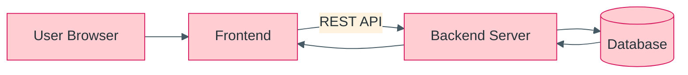
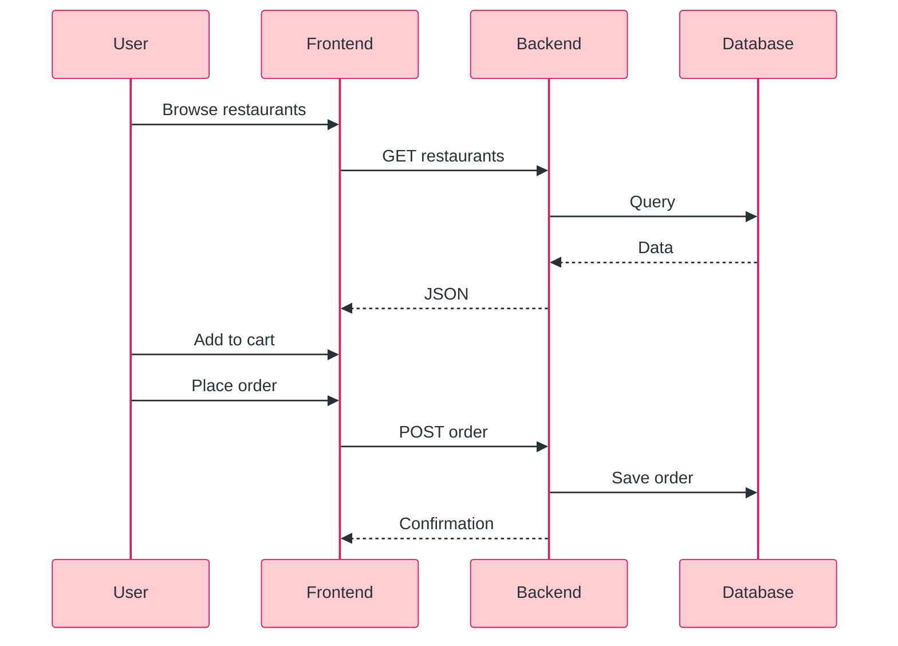

<div align="center">


### A full-stack web application for browsing restaurants, adding items to a cart, and placing orders. Developed with generative AI tools used to accelerate front-end and back-end development.

    

</div>

<!-- Remove or edit any badge that does not match your actual project. Update [USERNAME] and every [PLACEHOLDER]. -->

## 📋 At a Glance

| 🧭 Domain | 🧰 Stack | 📈 Level |
|---|---|---|
| Web Development / Full Stack | Frontend + Backend + Database | Intermediate |

<details>
<summary>📑 Table of Contents</summary>

- [📌 Overview](#-overview)
- [🎯 Problem Statement](#-problem-statement)
- [✨ Features](#-features)
- [🛠️ Technologies Used](#-technologies-used)
- [🧩 System Architecture](#-system-architecture)
- [🔄 Order Flow](#-order-flow)
- [🗄️ Database Design (edit to match yours)](#-database-design-edit-to-match-yours)
- [🔗 API Endpoints (document only what exists)](#-api-endpoints-document-only-what-exists)
- [📁 Project Structure](#-project-structure)
- [🚀 Installation](#-installation)
- [▶️ Usage](#-usage)
- [📸 Screenshots](#-screenshots)
- [🤖 Note on AI-Assisted Development](#-note-on-ai-assisted-development)
- [📊 Results](#-results)
- [⚠️ Limitations](#-limitations)
- [☁️ Deployment (optional)](#-deployment-optional)
- [🎤 Presentation Outline](#-presentation-outline)
- [🔮 Future Enhancements](#-future-enhancements)
- [📄 License](#-license)

</details>

---


## 📌 Overview
Users can view restaurants and menus, add items to a cart and place an order. The project covers a client interface, a server API and a database.

## 🎯 Problem Statement
To build a simple end-to-end ordering workflow that demonstrates how a client, server and database work together in a typical web application.

## ✨ Features
**Implemented (per resume, confirm each):**
- [ ] Restaurant browsing
- [ ] Cart
- [ ] Ordering
- [ ] User-friendly interface

**Recommended (not implemented unless you build them):**
- [ ] Authentication
- [ ] Order status tracking
- [ ] Admin panel for restaurants/menus
- [ ] AI-based dish suggestions

## 🛠️ Technologies Used
| Layer | Technology |
|---|---|
| Frontend | [HTML/CSS/JS or React] |
| Backend | [Node.js + Express / Flask / other] |
| Database | [MongoDB / MySQL / SQLite] |
| Tools | Git, [Postman], generative AI coding tools |

## 🧩 System Architecture



## 🔄 Order Flow



## 🗄️ Database Design (edit to match yours)
| Collection / Table | Fields |
|---|---|
| restaurants | id, name, [fields] |
| menu_items | id, restaurant_id, name, price, [fields] |
| orders | id, items, total, created_at, [fields] |
| users (if implemented) | id, name, email, [fields] |

## 🔗 API Endpoints (document only what exists)
| Method | Endpoint | Purpose |
|---|---|---|
| GET | `/api/[restaurants]` | List restaurants |
| GET | `/api/[restaurants/:id/menu]` | Menu items |
| POST | `/api/[orders]` | Place an order |

## 📁 Project Structure
```
food-delivery-fullstack-app/
├── README.md
├── LICENSE
├── .env.example
├── frontend/
├── backend/
├── docs/
│   ├── architecture.png
│   ├── api.md
│   ├── er_diagram.png
│   ├── screenshots/
│   ├── project_report.pdf
│   └── presentation/Food_Delivery_App.pptx
└── tests/
```

## 🚀 Installation
1. Clone the repository.
2. Backend: `cd backend`, then `[npm install / pip install -r requirements.txt]`.
3. Copy `.env.example` to `.env` and fill values `[DATABASE_URL, PORT]`. Never commit `.env`.
4. Start backend: `[command]`.
5. Frontend: `cd frontend`, then `[npm install]` and `[npm start]`.
6. Open `[http://localhost:PORT]`.

## ▶️ Usage
1. Open the app and choose a restaurant.
2. Add items to the cart.
3. Review the cart and place the order.

## 🤖 Note on AI-Assisted Development
> [!NOTE]
> Generative AI tools were used to speed up front-end and back-end development. All code was reviewed, tested and understood by the author.


## ☁️ Deployment (optional)
Frontend: `[Netlify / Vercel]`. Backend: `[Render / similar]`. Database: `[hosted DB]`. Live link: [ADD ONLY IF WORKING].

## 🎤 Presentation Outline

<details>
<summary>View slide-by-slide outline</summary>

1. Title 2. Problem 3. Objectives 4. Architecture 5. Tech stack 6. Database design 7. API design 8. Demo screenshots 9. AI-assisted development approach 10. Challenges 11. Future scope 12. Conclusion

</details>

## 🔮 Future Enhancements
- [ ] Authentication
- [ ] Order tracking
- [ ] Admin panel
- [ ] Automated tests
- [ ] AI-based suggestions

## 👩‍💻 Author

<div align="center">

**Sai Sravani Addagiri** | B.Tech ECE | Lakireddy Bali Reddy College of Engineering

<a href="https://linkedin.com/in/sai-sravani-addagiri-147640291"></a> <a href="mailto:saisravani287@gmail.com"></a> <a href="https://github.com/[USERNAME]"></a>

</div>


<div align="center">

</div>
